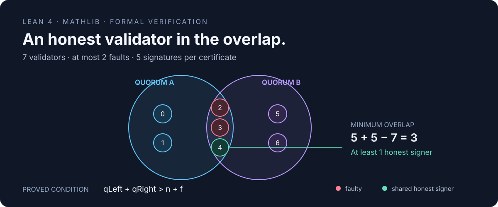

# Lean Quorum

[](docs/VERIFICATION.md)


[](LICENSE)

**Machine-checked quorum intersection, Byzantine certificate agreement, and voting thresholds in Lean 4 + Mathlib.**



Two certificates can each look convincing and still certify conflicting values.
The missing ingredient is an **honest validator in their overlap**. This project
formalizes that argument from finite signer sets through to certificate agreement,
including weighted voting, accountability, boundary counterexamples, and an
executable checker whose Boolean result has a proved specification.

## The central result

For a fixed committee with `n` distinct validators and at most `f` faulty validators:

```text
qLeft + qRight > n + f
          ↓
Every pair of quorums shares an honest validator
          ↓
Honest validators do not double-vote in this instance
          ↓
The two certified values are equal
```

This includes the familiar `n = 3f + 1`, `q = 2f + 1` configuration. The proof
also supports unequal thresholds and natural-number voting weights.

## Start with the reviewable evidence

Read the [reviewer guide](docs/REVIEWER_GUIDE.md), then inspect the
[executable vote collector and inductive invariant](LeanQuorum/BallotBox.lean)
and the [synthetic formalization-review cases](LeanQuorum/ReviewCases.lean).
The collector proves honest no-double-voting for arbitrary input traces and
connects that invariant to certificate agreement across growing snapshots.

## What is proved

**61 explicitly declared theorems** across eight formal modules.

| Result | Lean declaration |
| --- | --- |
| Quantitative lower bound on honest overlap | [`quorum_honest_card_bound`](LeanQuorum/Intersection.lean) |
| Honest intersection under asymmetric thresholds | [`exists_honest_intersection`](LeanQuorum/Intersection.lean) |
| Executable collector preserves its invariant for every finite trace | [`process_preserves_invariant`](LeanQuorum/BallotBox.lean) |
| Certificates from processed traces agree | [`processed_certificate_agreement`](LeanQuorum/BallotBox.lean) |
| Earlier and later processed certificates agree | [`processed_snapshot_agreement`](LeanQuorum/BallotBox.lean) |
| Concrete countermodels to omitted assumptions and duplicate counting | [`ReviewCases`](LeanQuorum/ReviewCases.lean) |
| Agreement of authenticated vote certificates | [`certificate_agreement`](LeanQuorum/Certificates.lean) |
| Conflicting certificates expose a minimum fault count | [`conflicting_certificates_fault_bound`](LeanQuorum/Certificates.lean) |
| Agreement across growing vote snapshots | [`agreement_across_snapshots`](LeanQuorum/Certificates.lean) |
| Agreement with weighted validators | [`weighted_certificate_agreement`](LeanQuorum/Weighted.lean) |
| Smallest safe threshold is `⌊(n + f) / 2⌋ + 1` | [`safe_iff_minimum_le`](LeanQuorum/Threshold.lean) |
| Safety and count-based availability are compatible iff `3f < n` | [`safe_available_iff`](LeanQuorum/Threshold.lean) |
| Removing faulty validators leaves an available honest quorum | [`honest_quorum_available`](LeanQuorum/Intersection.lean) |
| Executable checker is sound and complete for its finite input | [`checkSafety_iff`](LeanQuorum/Checker.lean) |

See the [complete theorem index](docs/THEOREMS.md) and [model and proof walkthrough](docs/MODEL.md).

## A counterexample with actual certificates

Take three validators, threshold two, and one faulty validator:

```text
Validator 0 (faulty): votes for false AND true
Validator 1 (honest): votes only for false
Validator 2 (honest): votes only for true

Certificate A: {0, 1} → false
Certificate B: {0, 2} → true
Intersection: {0}    → entirely faulty
```

Both certificates have a strict majority. Every honest validator follows the
voting rule. Agreement still fails. The full construction, the non-strict
inequality boundary, exactly-half disjoint quorums, and safe configurations are
[checked in Lean](LeanQuorum/Counterexamples.lean).

## Build and run

Install [elan](https://github.com/leanprover/elan), then:

```bash
git clone https://github.com/starkbbk/lean-quorum.git
cd lean-quorum
lake exe cache get
python3 scripts/verify.py
```

The toolchain and all dependencies are pinned in `lean-toolchain` and
`lake-manifest.json`. The initial Mathlib cache download is substantial.

Individual steps:

```bash
lake build                    # All formal modules and the demo executable
lake env lean Audit.lean       # Check every project declaration's axiom closure
lake exe quorum-demo          # Run scenarios and the exhaustive finite sweep
```

The demo checks every quorum pair for **240 configurations**: `n = 0..7`,
`f = 0..n`, `q = 0..n+1`, with the fixed fault set `{0, …, f-1}`. It compares
the enumerator against the arithmetic threshold condition. This finite sweep
supplements the universal proofs; it does not replace them. Enumeration is
exponential and is intended for small committees.

## Continuous integration

A GitHub Actions configuration is included in [`ci/lean-verification.yml`](ci/lean-verification.yml).
To enable automatic verification, place it at `.github/workflows/ci.yml` using
a GitHub session or token with workflow-write permission. Automatic CI is not
enabled in this initial publication; the [verification record](docs/VERIFICATION.md)
reports the completed local checks.

## Trust and scope

- Proofs are checked by Lean's kernel. The audit permits only the foundational
  axioms `propext`, `Classical.choice`, and `Quot.sound`; it rejects unfinished
  proofs, project-defined axioms, and other axiom dependencies.
- The verification script tests that the audit actually rejects an injected
  unfinished proof and an injected axiom in temporary files.
- The model assumes authenticated validator identities and honest validators
  voting for at most one value **within one fixed voting instance**.
- Committees and weights are fixed. The project proves certificate safety and
  count-based quorum availability. Network behavior, signature cryptography,
  multi-round protocols, reconfiguration, and protocol termination are outside
  this model.

This is a focused formalization of standard quorum arguments. Development used
AI assistance. The source, executable specification, and reproducible checks are
the evidence for its mathematical claims.

## Project map

```text
LeanQuorum/
  Intersection.lean     Finite quorums, honest overlap, availability
  Threshold.lean        Minimum thresholds and the one-third frontier
  Certificates.lean     Agreement, accountability, snapshot extension
  Weighted.lean         Natural-number voting weights
  Checker.lean          Executable checker with a proved specification
  Counterexamples.lean  Explicit boundary cases and conflicting certificates
  BallotBox.lean        Executable collector, inductive invariant, trace agreement
  ReviewCases.lean      Synthetic specification-review cases and countermodels
Audit.lean              Dependency audit of every project declaration
Main.lean               Runnable examples and exhaustive regression sweep
scripts/verify.py       Reproducible verification, including negative audit tests
```

MIT licensed. Mathlib and other dependencies retain their own licenses.
